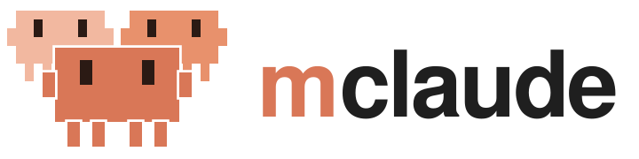

<h1 align="center">
  
</h1>

<h3 align="center">One Claude Code account per project.<br>Switches automatically when you <code>cd</code>.</h3>

<p align="center">
  <code>mclaude add</code> · <code>mclaude bind</code> · <code>mclaude which</code>
</p>

<p align="center">
  <a href="https://github.com/TOMOSIA-VIETNAM/mclaude/actions/workflows/test.yml"></a>
  <a href="https://github.com/TOMOSIA-VIETNAM/mclaude/releases"></a>
  <a href="LICENSE"></a>
  
  
  
</p>

<p align="center">English · <a href="README.vi.md">Tiếng Việt</a></p>

`mclaude` lets you use several Claude Code (subscription) accounts on one machine. Each project is bound to an account; when you `cd` into the project and run `claude`, the matching account is used automatically.

- Writes nothing into project folders — nothing to accidentally commit.
- Settings, skills, plugins, hooks and `CLAUDE.md` are shared across accounts.
- Claude Code CLI on zsh (macOS) only.

The control command is `mclaude`. It is a shell function defined by this tool (not a system or Claude Code command), loaded into zsh at install time.

## Why

Claude Code signs in one account per config directory, and by default that is `~/.claude` for everything. If you work with more than one subscription — your company's, a client's, your own — switching means signing out and in again, and it is easy to run a client project on the wrong account.

`mclaude` makes the folder decide:

- **Company and client work:** `~/Project/ClientX` always uses the account the client pays for, the rest of `~/Project` uses the company account.
- **Work and personal:** side projects use your personal subscription, work repos never do.
- **Separate history and memory:** each account keeps its own conversations and project memory, so nothing from one client shows up in another.

You set it up once per folder; after that, `cd` and `claude` is all there is.

## How it works

Claude Code reads the `CLAUDE_CONFIG_DIR` environment variable to locate its config directory (login session, history, memory). The tool gives each account its own config directory and wraps the `claude` command in a shell function:

1. Take the current directory (`$PWD`).
2. Look it up in the map file `~/.mclaude/projects.conf` and pick the line with the **longest** matching path (subdirectories inherit their parent's profile).
3. Set `CLAUDE_CONFIG_DIR=~/.mclaude/profiles/<profile>` and run the real Claude Code.
4. If nothing matches, use `~/.claude` as usual (the `default` profile).

```
~/.claude/                         # "default" profile + shared config source (never modified by the tool)
~/.mclaude/                    # everything the tool owns lives here
├── mclaude.zsh                    # the script, sourced from ~/.zshrc
├── completions/_mclaude           # zsh tab completion
├── projects.conf                  # map: path → profile
└── profiles/
    ├── client-x/                  # account B
    │   ├── settings.json -> ~/.claude/settings.json
    │   ├── skills        -> ~/.claude/skills
    │   ├── ...                    # other shared symlinks
    │   ├── .claude.json           # private: account info, onboarding
    │   └── projects/              # private: memory, history
    └── client-y/                  # account C
```

## Install

One command:

```zsh
./install.sh && source ~/.zshrc
```

`install.sh` will:
- Create `~/.mclaude/` (with `profiles/` and `projects.conf`) and **copy** `mclaude.zsh` into it — you can delete the repo afterwards.
- Append one `source ~/.mclaude/mclaude.zsh` line to `~/.zshrc` (only once).
- Clean up the old `~/.config/claude-switch` layout if present.

Re-run `install.sh` any time to update the script; profiles and bindings are kept.

`source ~/.zshrc` loads `mclaude` into the current terminal; new terminals get it automatically.

Check:

```zsh
mclaude list
mclaude which
```

## Quick start

Example: use company B's account for every project under `~/Project/ClientX`.

```zsh
mclaude add client-x                      # 1. create the profile
mclaude login client-x                    # 2. sign in to account B (opens a browser)
mclaude bind client-x ~/Project/ClientX   # 3. bind the folder to the profile

cd ~/Project/ClientX/api
claude                                    # → runs with account B
```

Check which account is in use:

```zsh
cd ~/Project/ClientX && mclaude status    # account B
mclaude status default                    # original account, unaffected
```

## Commands

| Command | Description |
|---|---|
| `mclaude` / `mclaude which` | Print the profile and config dir for the current directory |
| `mclaude list` | List profiles with the account each is signed in to, and all bindings |
| `mclaude add <profile>` | Create a profile in `~/.mclaude/profiles/<profile>` with shared-config symlinks |
| `mclaude remove [-y] <profile>` | Sign out, delete the profile folder (login, memory, history) and drop its bindings. Asks for confirmation unless `-y` |
| `mclaude login [profile]` | Sign in for a profile (default: the current directory's profile) |
| `mclaude logout [profile]` | Sign out of a profile |
| `mclaude status [profile]` | Show a profile's sign-in status |
| `mclaude bind <profile> [path]` | Bind a folder to a profile (default: current directory). Re-binding the same folder replaces the old line |
| `mclaude unbind [path]` | Remove a folder's binding (default: current directory) |
| `mclaude doctor` | Check the setup: `claude` on PATH, the `~/.zshrc` hook, sign-in of every profile, two profiles on the same account, broken shared symlinks, bindings to missing profiles or folders. Exits non-zero if something is broken |
| `mclaude version` | Print the mclaude version (also `--version`, `-v`) |
| `mclaude help` | Show usage |
| `claude ...` | Run Claude Code with the current directory's profile; all arguments are passed through unchanged |

The name `default` is reserved for `~/.claude`.

Example `mclaude list`:

```
profiles:
  default   me@personal.dev  (/Users/me/.claude)
  client-x  me@client-x.com
  client-y  not signed in
bindings (/Users/me/.mclaude/projects.conf):
  /Users/me/Project/ClientX client-x
```

**Tab completion:** `install.sh` installs a zsh completion for `mclaude` (commands, profile names, folders; `unbind` offers the bound folders). It works whether `compinit` runs before or after the `source` line in `~/.zshrc`.

## The `projects.conf` map

Each line: `<path> <profile>`. The profile is the last word, so paths may contain spaces. Lines starting with `#` are comments. `~` is allowed.

```
# ~/.mclaude/projects.conf
/Users/admin/Project/ClientX            client-x
/Users/admin/Project/ClientX/legacy     client-y
~/Project/My Side Project               personal
```

With the map above:

| Current directory | Profile |
|---|---|
| `~/Project/ClientX/api` | `client-x` |
| `~/Project/ClientX/legacy/web` | `client-y` (longer match) |
| `~/Project/My Side Project` | `personal` |
| `~/Downloads` | `default` |

Edit the file by hand or use `mclaude bind` / `mclaude unbind`. Paths reached through symlinks are resolved to their real path before matching.

## Shared config

When a profile is created (and each time `claude` runs with it), these items from `~/.claude` are symlinked into the profile if they exist:

```
settings.json  CLAUDE.md  keybindings.json  skills  plugins  hooks
agents  commands  output-styles  statusline.sh
```

Change something in `~/.claude` and every profile sees it. To share more items, add them to the `MCLAUDE_SHARED` array in `mclaude.zsh`. To give one profile its own copy of an item, delete the symlink in the profile folder and put a real file there — `mclaude` never overwrites existing files.

**Not shared** (per profile): login session, `.claude.json` (account info, user-scope MCP servers), `projects/` (per-project memory and history).

## Environment variables

Set these before the `source` line in `~/.zshrc` to change the default locations:

| Variable | Default | Meaning |
|---|---|---|
| `MCLAUDE_HOME` | `~/.mclaude` | Where `projects.conf` lives |
| `MCLAUDE_PROFILES` | `$MCLAUDE_HOME/profiles` | Where profile folders live |
| `MCLAUDE_BASE` | `~/.claude` | The `default` profile and shared-config source |

## Limitations

- **zsh on macOS only.** bash, fish and Linux are not supported.
- **Only `claude` started from zsh goes through the wrapper.** The VS Code/JetBrains extensions, the Claude desktop app, claude.ai, `sh`/`bash` scripts, cron jobs, and calling the binary directly (`command claude`, `~/.local/bin/claude`) all use their own config — normally `~/.claude`.
- **No account switch mid-session.** The profile is chosen when `claude` starts. If you move to another project during a session, exit and start again.
- **One account per folder.** For a one-off run with another account, set `CLAUDE_CONFIG_DIR` yourself (see below).
- **Subscription accounts in mind.** API-key setups work per profile too, but the tool does not manage keys.

## Notes

- **Manual override:** if `CLAUDE_CONFIG_DIR` is already set in the environment, the wrapper respects it and skips the map. Example of a one-off run with another account: `CLAUDE_CONFIG_DIR=~/.mclaude/profiles/client-y claude`.
- **User-scope MCP servers** live in each profile's `.claude.json`, so add them again per profile (`claude mcp add --scope user ...`).
- **macOS Keychain:** each profile keeps its own subscription login in the Keychain, so signing in to one profile does not replace another (tested with real accounts).
- If `mclaude login` does not work with your Claude Code version, go to the project folder, run `claude`, then type `/login`.

## Running tests

```zsh
zsh tests/test.zsh
```

No dependencies. Each test runs in a temporary HOME with a fake `claude`, so the real `~/.claude`, `~/.mclaude` and `~/.zshrc` are never touched. Covered: profile resolution (subdirectories, longest match, sibling paths, spaces, symlinks, `~`, comments), the `CLAUDE_CONFIG_DIR` override, profile creation and shared symlinks, `bind`/`unbind`/`list` (with accounts)/`which`/`help`/`version`, `remove` (confirmation, `-y`, bindings dropped), `doctor`, `login`/`logout`/`status`, tab completion, robustness against user shell options, `install.sh` (fresh, re-run, old-layout migration) and `uninstall.sh` (keep or delete profiles, including the interactive prompt).

Real sign-in and Keychain separation are not automated; they have been checked by hand with real accounts.

## Uninstall

One command:

```zsh
./uninstall.sh
```

- Removes the `source` line from `~/.zshrc`.
- If profiles exist, asks whether to delete them (default **no**):
  - `N`: removes only `mclaude.zsh`, the completion and `projects.conf`, keeping `~/.mclaude/profiles/` — reinstall later to keep using them.
  - `y`: signs out of each profile, then deletes all of `~/.mclaude`. **This permanently deletes the login sessions, memory and history of those accounts.**
- Remove everything without asking (for scripts): `./uninstall.sh --purge`.

`~/.claude` (the `default` profile) is never touched. After uninstalling, open a new terminal (or run `exec zsh`) so the current shell drops `mclaude`.

## Contributing

Issues and pull requests are welcome — see [CONTRIBUTING.md](CONTRIBUTING.md). To report a security problem, follow [SECURITY.md](SECURITY.md) instead of opening a public issue.

## Disclaimer

`mclaude` is an independent, unofficial project. It is not affiliated with, endorsed by, or supported by Anthropic. "Claude" and "Claude Code" are trademarks of Anthropic, PBC.

The tool only selects which config directory Claude Code uses; it does not touch authentication, tokens or Anthropic's services. You are responsible for making sure your use of each account complies with [Anthropic's terms and policies](https://www.anthropic.com/legal) and with your organization's rules. The software is provided as is, without warranty (see [LICENSE](LICENSE)).

## License

[MIT](LICENSE)
